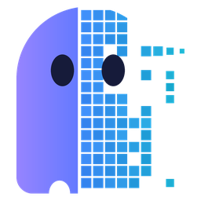
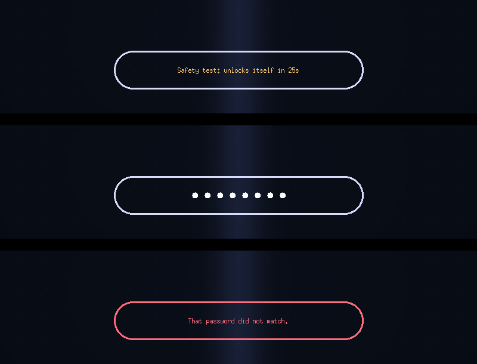
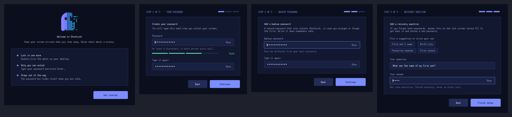
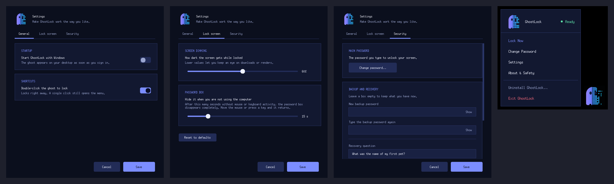

<p align="center">
  
</p>

<h1 align="center">GhostLock</h1>
<p align="center"><b>A transparent privacy screen for Windows.</b><br>
Step away from your PC without closing anything. Double-click the ghost, and your screen dims behind a see-through password box.</p>

<p align="center">
  <a href="../../releases/latest"><b>Download for Windows</b></a> &nbsp;·&nbsp; Windows 10 / 11 &nbsp;·&nbsp; Free &amp; open source (MIT)
</p>

<p align="center"></p>

## Why GhostLock?
Downloads, renders, long exports, a quick coffee break: you want people not to see your screen, but you don't want to close apps or sign out. GhostLock covers the screen, lets everything keep running underneath, and only asks for a password when you come back.

- **Double-click the ghost** to lock instantly. Single-click opens the menu.
- **Transparent password box.** Just a clean capsule. No blur, no clutter.
- **Hides when idle.** After about 15 seconds without mouse or keyboard activity the password box disappears completely. Move the mouse or press a key to bring it back.
- **Two ways in.** A main password and a backup password, plus a recovery question if you forget both.
- **Private.** No account, no internet, no tracking. Passwords are stored only as salted hashes on your PC.
- **Easy to remove.** Uninstall from the ghost menu, Windows Settings or the Start Menu.

## Install
1. Open the [latest release](../../releases/latest) and download **`Setup.exe`**.
2. Run it and click **Install**. No administrator rights are needed; it installs for your user only.
3. Follow the short setup: choose a password, a backup password and a recovery question.
4. Look for the ghost on your desktop. Double-click it to lock.

> **Windows says "Windows protected your PC"?** GhostLock is a new, unsigned app, so SmartScreen may warn you. Click **More info > Run anyway**. Some antivirus tools are cautious about any program that covers the screen; you can read the full source in this repository and build it yourself.

<p align="center"></p>

## How to use it
| Do this | To get this |
| --- | --- |
| Click the ghost | Open the menu (Lock Now, Change Password, Settings, About, Uninstall, Exit). Drag the ghost to move it |
| Double-click the ghost | Lock instantly |
| Type your password, press `Enter` | Unlock (main or backup password) |
| `Esc` | Clear what you typed |
| `F1`, `Ctrl+R` or right-click | Recovery question (forgot your passwords) |
| Stay idle ~15 s | The password box fades out completely; any movement brings it back |
| `Ctrl+Alt+Del` | Always available. This is your emergency exit |

Your **first lock is a safe test**: it unlocks itself after 25 seconds. After one successful unlock it stays locked until you enter a password.

## Settings
<p align="center"></p>

- **General:** start with Windows, double-click to lock.
- **Lock screen:** how dark the screen gets (lower = you can watch downloads or renders), and how long before the password box hides.
- **Security:** change your password, backup password and recovery question.

## Important: what GhostLock is (and isn't)
GhostLock is a **soft privacy screen** for short breaks. It is **not** a replacement for Windows Lock (`Win+L`), BitLocker or account passwords. Windows keeps `Ctrl+Alt+Del`, UAC prompts, restart and sign-out available by design, and someone with access to your PC could end the app from Task Manager. For real security, use Windows Lock. See [SECURITY.md](SECURITY.md).

## FAQ
**I forgot my password.** On the lock screen press `F1`, answer your recovery question and choose a new password. Or use your backup password.
**Can I turn off double-click?** Yes: Settings > General.
**Where is my data?** `%APPDATA%\GhostLock\config.json` (hashed passwords and settings) and `ghostlock.log` (errors only).
**How do I uninstall?** Ghost menu > *Uninstall GhostLock…*, or Windows Settings > Apps, or the Start Menu shortcut.
**Does it need internet or admin rights?** No.

## For developers
Windows 10/11 and Python 3.10+ (Tkinter is included with the standard installer).

```powershell
py ghostlock.py                       # run from source
py -m unittest discover -s tests      # tests
.\build.ps1 -InstallPyInstaller       # once
.\build.ps1 -SetupOnly                # builds dist\Setup.exe
```

```text
ghostlock.py        entry point and app controller
gl_core.py          config, hashing, brute-force guard, Windows integration (no GUI)
gl_theme.py         palette, DPI scaling, custom widgets
gl_windows.py       setup, installer, uninstaller, settings, about, floating ghost
gl_lock.py          the transparent lock screen
assets/             logo and icons (regenerate with tools/make_icons.py)
```

Contributions are welcome. See [CONTRIBUTING.md](CONTRIBUTING.md) and [CHANGELOG.md](CHANGELOG.md).

## Credits and license
Created by **MD ABID HASAN**, published by **MDexpLab**. Copyright (c) 2026 MD ABID HASAN / MDexpLab. Released under the [MIT License](LICENSE). Please keep attribution in distributions; modified builds should not be presented as official MDexpLab releases.
